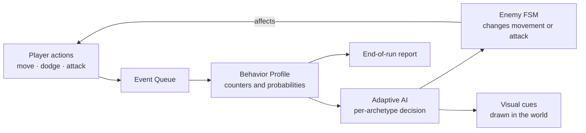
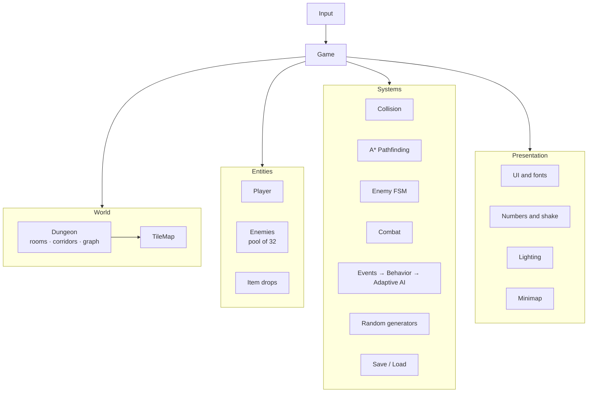

<div align="center">

# ⚔️ DungeonForge

### A 2D roguelike in pure C where the enemies learn how *you* play


-0078D6)


**Procedural dungeons · A\* pathfinding · Adaptive enemy AI · 3-phase boss · Dynamic lighting · Save / Load**

[Proposal](#-project-proposal) •
[Features](#-features) •
[Adaptive AI](#-adaptive-enemy-intelligence) •
[Controls](#-controls) •
[Build](#-build-and-run) •
[Architecture](#-design-and-architecture)

</div>

---

## 📸 Screenshots

| Title Menu | Gameplay |
|:---:|:---:|
|  |  |

| Adaptive AI Cues | Boss Fight |
|:---:|:---:|
|  |  |

| End-of-Run Report: *What the enemies learned* |
|:---:|
|  |

---

## 📋 Project Proposal

### Description

DungeonForge is a real-time 2D top-down roguelike. The player explores a procedurally generated dungeon, fights enemies, collects health potions, and defeats a multi-phase boss.

The whole project is written in **C only**. Every system (game loop, collision, pathfinding, AI, event queue, lighting, save/load) is implemented from scratch. raylib is used only for the window, drawing, input, and audio.

What makes it different is **Adaptive Enemy Intelligence**: the game records how the player moves, dodges, and attacks, builds a statistical profile, and lets enemies pick counter-strategies from it. The AI's decisions are drawn directly in the world, and an end-of-run report tells the player what the enemies learned about them. No machine learning is used, only counters, probabilities, and decision rules.

### 🎯 Goals

- Show structured, modular C programming: clear headers, small modules, no hidden coupling
- Implement classic game algorithms by hand: tile collision, A\*, finite-state machines, procedural generation, a pseudo-random generator
- Build an event-driven analysis pipeline that changes gameplay and is visible to the player
- Persist game state with versioned, validated binary serialization
- Verify the logic-heavy modules with automated tests
- Follow good repository practice: `.gitignore`, `Makefile`, meaningful commits, license, documentation

### 📐 Specifications

| | |
|---|---|
| **Language** | C17 (`-std=c17 -Wall -Wextra`) |
| **Graphics / audio** | raylib 6.0 |
| **Build system** | GNU Make |
| **Platform** | Windows, MinGW-w64 |
| **Window** | 1280 × 720 at 60 FPS |
| **World** | 40 × 22 tile map, 32 px tiles |
| **Dungeon** | up to 20 rooms, spanning-tree connectivity, 2-tile-wide corridors |
| **Enemies** | Hunter, Guardian, Assassin + 3-phase Boss |
| **Pathfinding** | 8-direction A\*, no corner cutting |
| **Save format** | binary, magic number + version header, full validation on load |
| **Font** | Pixelify Sans (SIL Open Font License) |

---

## ✨ Features

<table>
<tr>
<td width="50%" valign="top">

**🎮 Gameplay**
- 8-direction movement
- Dodge roll with invulnerability frames
- Real-time melee combat (cone attack)
- Inventory (12 slots), item drops, potions
- 3-phase boss with a special attack
- Title menu, pause screen, end-of-run report

</td>
<td width="50%" valign="top">

**🧠 Systems**
- Procedural dungeon + dungeon graph
- A\* pathfinding with safe waypoints
- Enemy finite-state machines
- Event queue and player profiling
- Independent random generators per module
- Versioned, validated binary save / load

</td>
</tr>
<tr>
<td width="50%" valign="top">

**🎨 Look and feel**
- Dynamic lighting: player torch, enemy glows, item glows
- Tinted rooms and a vignette
- Dodge cooldown ring
- Floating damage and heal numbers
- Screen shake and a low-health warning
- Custom pixel font and a polished HUD

</td>
<td width="50%" valign="top">

**🗺️ Information**
- Minimap with fog of war
- Boss health bar with phase markers
- Enemy cues drawn in the world
- Debug overlays (labels, dungeon graph, A\*)
- Save/load status messages

</td>
</tr>
</table>

---

## 🧠 Adaptive Enemy Intelligence



Each enemy asks the AI for a decision about once per second. A decision only takes effect when a **probability roll succeeds**, so enemies are strong but never perfectly predictable.

| Enemy | Reads | Reaction | What you see |
|---|---|---|---|
| 🔺 **Hunter** | dodge habits (movement as fallback) | predicts your likely dodge direction and aims slightly ahead of it | red dashed line and crosshair |
| 🛡️ **Guardian** | how much you have attacked recently | defends when you attack heavily (takes less damage), attacks faster when you are passive | cyan shield ring or red spikes |
| 🔷 **Assassin** | dodge habits (movement as fallback) | flanks the side opposite your habit, or rushes you if you dodge vertically | purple or gold line and crosshair |
| 👑 **Boss** | dodge habits (movement as fallback) | flanks or closes distance based on your tendencies | purple or gold line and crosshair |

The learned profile is stored in the save file, so loading a game keeps what the enemies have learned. The end-of-run screen tells you what they learned, for example *"You dodge left 78% of the time"*.

<details>
<summary><b>👑 Boss phases</b></summary>

| Phase | Health | Speed | Behavior |
|---|---|---|---|
| I | above 70% | 150 | melee attack |
| II | 70% to 40% | 175 | melee + special attack |
| III | below 40% | 210 | enraged: faster melee, faster special |

The boss is stagger-resistant, so rapid hits cannot cancel its attacks.

</details>

---

## 🕹️ Controls

| Key | Action |
|:---:|---|
| `W` `A` `S` `D` | Move |
| `Shift` | Dodge |
| `Space` | Melee attack |
| `H` | Drink health potion |
| `ESC` / `P` | Pause |
| `R` | New run (after death or victory) |
| `M` | Main menu (from pause or the end screen) |
| `TAB` | Show or hide the minimap |
| `F1` | Show or hide the debug footer |
| `F2` | Lighting on or off |
| `F3` | Enemy labels (type, state, decision) |
| `F4` | Dungeon graph overlay |
| `F5` | A\* pathfinding overlay |
| `F6` | Save game |
| `F7` | Load game |

In the main menu: `ENTER` starts a new run, `L` loads a save, `ESC` quits.

---

## 🛠️ Build and Run

### Prerequisites

- Windows with **MinGW-w64 (GCC)** and **GNU Make**
- **raylib 6.0** for Windows / MinGW-w64

### Quick start

```bash
# 1. Clone
git clone https://github.com/RaghavKansal-07/DungeonForge.git
cd DungeonForge

# 2. Build
make

# 3. Run (from the project root, so assets load correctly)
./dungeonforge
```

### One-time raylib setup

The repository includes the raylib **headers**, but not the compiled library. Download `raylib-6.0_win64_mingw-w64` from the [raylib releases](https://github.com/raysan5/raylib/releases) and extract it into `third_party/` so this exists:

```text
third_party/raylib-6.0_win64_mingw-w64/lib/libraylib.a
```

### Other commands

| Command | Does |
|---|---|
| `make` | build the game |
| `make test` | build and run all test suites |
| `make clean` | remove build outputs |

---

## 🧪 Testing

```bash
make test
```

**6 suites, 191 automated checks.**

| Suite | Verifies |
|---|---|
| `test_events` | FIFO order, capacity, wrap-around, empty queue, NULL handling |
| `test_behavior` | counters, probabilities, decaying attack score, profile restore and validation |
| `test_adaptive_ai` | decision validity, per-archetype behavior, probabilistic adaptation, vertical-dodge handling |
| `test_rng` | determinism, independence, ranges, distribution |
| `test_serialization` | round trip, truncated files, invalid arguments |
| `test_pathfinding` | valid and invalid inputs, same-tile and cross-room paths, unreachable goals |

These suites cover the modules that run without a window. Rendering, collision, player, and enemy FSM code are verified by playing the game.

---

## 📁 Project Structure

```text
DungeonForge/
├── Makefile
├── README.md
├── LICENSE
├── .gitignore
├── assets/
│   ├── audio/          sound effects (.ogg)
│   └── fonts/          Pixelify Sans + its OFL license
├── docs/screenshots/   images used by this README
├── include/            headers (.h)
├── src/                implementation (.c)
├── tests/              automated test programs
├── saves/              save-game directory
└── third_party/        raylib headers (library downloaded separately)
```

---

## 🏗️ Design and Architecture



**Key design decisions**

- 📦 **Fixed-size data structures** (event ring buffer of 256, enemy pool of 32, drop pool of 32): no dynamic allocation in the game loop.
- 📨 **Event-driven analysis**: gameplay code only pushes events and never touches the AI, so the AI can be tested without a window.
- 🎲 **Independent random generators**: the dungeon and the AI each own one, so generating a map never disturbs the AI's rolls, and tests can seed them.
- 🔐 **Versioned and validated saves**: a magic number and version reject foreign files, and the whole file is checked before any game state changes.
- 🎯 **Cues match behavior**: the on-screen AI cues are drawn from the same target the enemy steers toward, so what you see is what it does.
- ✅ **Tested logic core**: modules that do not depend on raylib are built and tested on their own.

---

## 🚧 Known Limitations and Roadmap

- [x] Boss phases with special attack and stagger resistance
- [x] Adaptive AI with probability rolls and visible cues
- [x] Learned profile saved with the game
- [x] Title menu, pause screen, and end-of-run report
- [x] Lighting, minimap, floating numbers, screen shake
- [ ] Random dungeon seed per run (currently fixed)
- [ ] Enemies placed across rooms, boss in the farthest room
- [ ] Attacks that follow the player's facing (currently hits right only)
- [ ] Attack wind-ups so dodging matters
- [ ] Combat distance tracked in the player profile
- [ ] Obtainable Iron Sword and Iron Armor (defined, not yet droppable)

Saves are binary and not portable across compilers or platforms.

---

## 📄 License

Released under the **MIT License**. See [LICENSE](LICENSE).

The bundled font, Pixelify Sans, is licensed under the SIL Open Font License (`assets/fonts/OFL.txt`).

<div align="center">

Built in C with ☕ and raylib

</div>