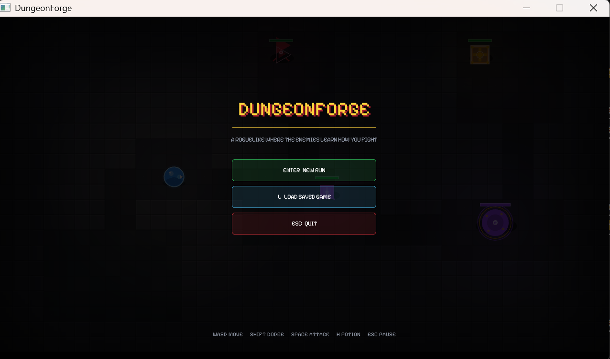
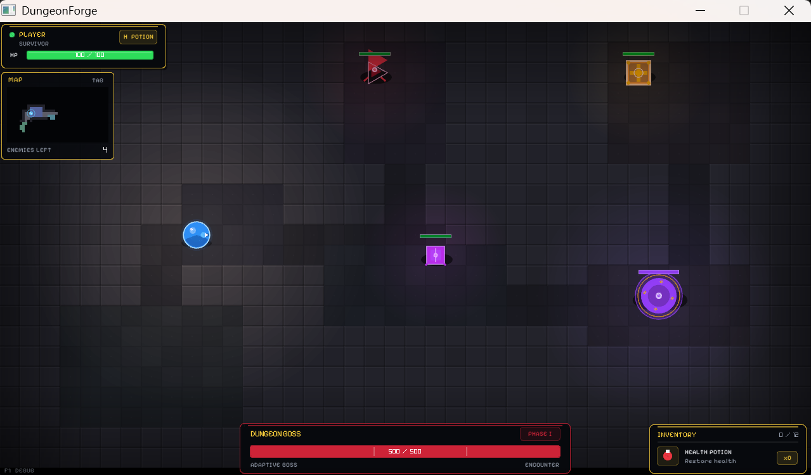
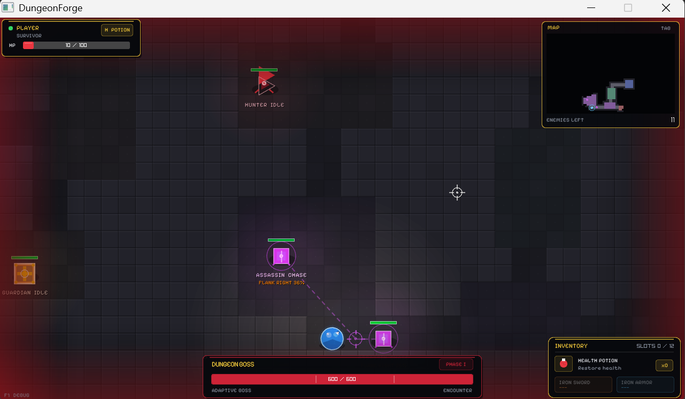
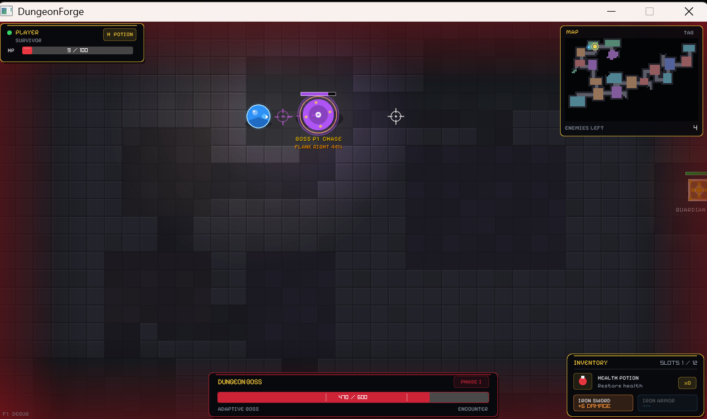
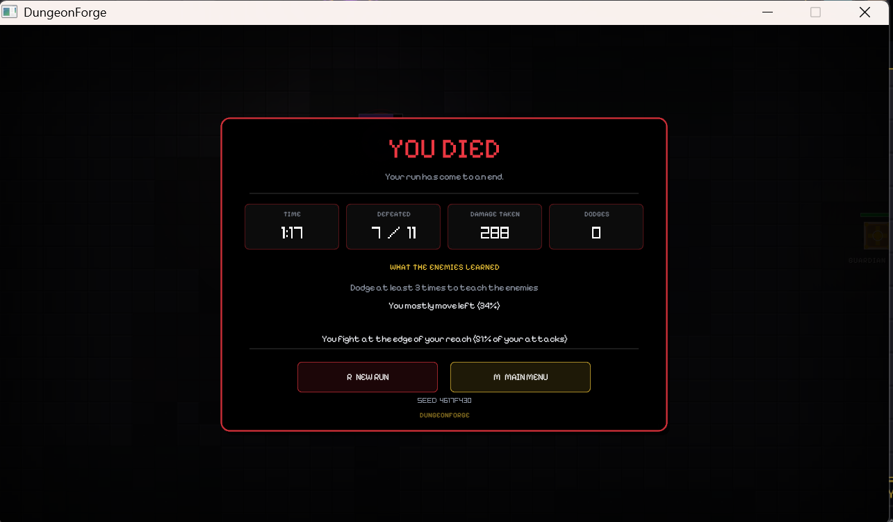
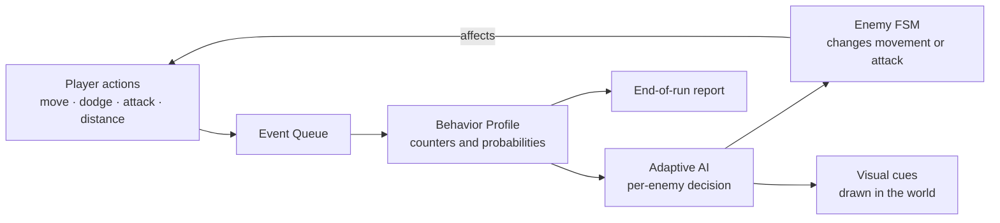
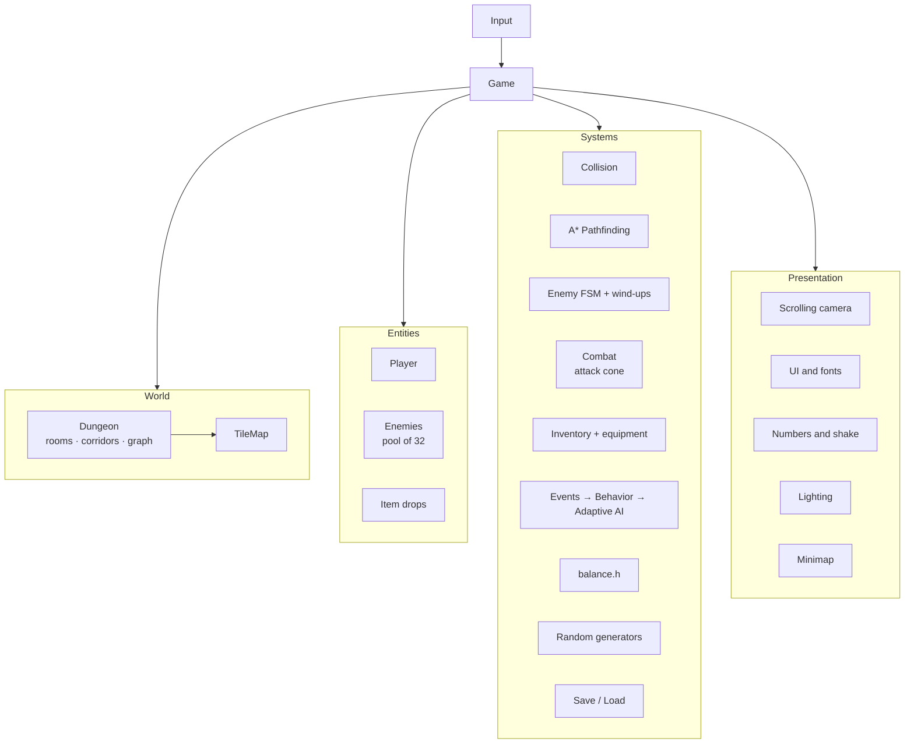

<div align="center">

# ⚔️ DungeonForge

### A 2D roguelike in pure C where the enemies learn how *you* fight


-0078D6)


**Random dungeons · Adaptive enemy AI · Telegraphed combat · Mouse aiming · 3-phase boss · Dynamic lighting · Save / Load**

[Proposal](#-project-proposal) •
[How it plays](#-how-it-plays) •
[Adaptive AI](#-adaptive-enemy-intelligence) •
[Controls](#-controls) •
[Build](#-build-and-run) •
[Testing](#-testing) •
[Architecture](#-design-and-architecture)

</div>

---

## 📸 Screenshots

| Title Menu | Gameplay |
|:---:|:---:|
|  |  |

| Adaptive AI Cues | Boss Fight |
|:---:|:---:|
|  |  |

| End-of-Run Report: *What the enemies learned* |
|:---:|
|  |

---

## 📋 Project Proposal

### Description

DungeonForge is a real-time 2D top-down roguelike. Every run generates a new dungeon from a seed. The player explores it with a scrolling camera, fights enemies with mouse-aimed melee attacks, collects potions and gear, and defeats a multi-phase boss hiding in the farthest room.

The whole project is written in **C only**. Every system (game loop, collision, pathfinding, AI, event queue, lighting, save/load) is implemented from scratch. raylib is used only for the window, drawing, input, and audio.

What makes it different is **Adaptive Enemy Intelligence**. The game records how the player moves, dodges, attacks, and from what distance. It builds a statistical profile and lets each enemy type pick a counter-strategy from it. The decisions are drawn directly in the world, and an end-of-run report tells the player what the enemies learned. No machine learning is used, only counters, probabilities, and decision rules.

### 🎯 Goals

- Show structured, modular C programming: clear headers, small modules, no hidden coupling
- Implement classic game algorithms by hand: tile collision, A\* with a binary heap, finite-state machines, procedural generation, a pseudo-random generator
- Build an event-driven analysis pipeline that changes gameplay and is visible to the player
- Keep the logic testable: pure modules with no game dependencies, covered by automated tests
- Persist game state with versioned, validated binary serialization
- Follow good repository practice: `.gitignore`, `Makefile`, meaningful commits, license, documentation

### 📐 Specifications

| | |
|---|---|
| **Language** | C17 (`-std=c17 -Wall -Wextra`), no warnings |
| **Graphics / audio** | raylib 6.0 |
| **Build system** | GNU Make |
| **Platform** | Windows, MinGW-w64 |
| **Window** | 1280 × 720 at 60 FPS, scrolling camera |
| **World** | 80 × 50 tiles of 32 px (2560 × 1600 px) |
| **Dungeon** | seeded, 12 to 32 rooms, spanning-tree connectivity, 2-tile corridors |
| **Enemies** | Hunter, Guardian, Assassin (up to 10 per dungeon) + a 3-phase Boss |
| **Pathfinding** | 8-direction A\*, binary-heap open list, octile heuristic |
| **Save format** | binary, magic number + version 7, whole file validated before loading |
| **Font** | Pixelify Sans (SIL Open Font License) |

---

## ✨ Features

<table>
<tr>
<td width="50%" valign="top">

**🎮 Gameplay**
- Random dungeon every run, with a replayable seed
- Mouse-aimed melee with a visible swing arc
- Dodge roll with invulnerability frames and a cooldown ring
- Telegraphed enemy attacks you can dodge or interrupt
- Iron Sword and Iron Armor drops with real effects
- Potions with limits, plus a mercy rule when you are low

</td>
<td width="50%" valign="top">

**🧠 Systems**
- Procedural dungeon and dungeon graph
- A\* pathfinding on a binary heap
- Enemy finite-state machines
- Event queue and player profiling
- Independent random generators per module
- Versioned, validated binary save / load

</td>
</tr>
<tr>
<td width="50%" valign="top">

**🎨 Look and feel**
- Dynamic lighting: player torch, enemy glows, tinted rooms
- Smooth scrolling camera with screen shake
- Floating damage and heal numbers
- Low-health warning that only appears in a fight
- Custom pixel font and a polished HUD
- Title menu, pause screen, end-of-run report

</td>
<td width="50%" valign="top">

**🗺️ Information**
- Minimap with fog of war that fades when you walk under it
- Boss health bar with phase markers
- Enemy decisions drawn in the world
- Equipment slots in the inventory panel
- Debug overlays (labels, dungeon graph, A\*)

</td>
</tr>
</table>

---

## 🎮 How It Plays

1. **Explore.** Each run builds a new dungeon. You start in one room, every other room holds an enemy, and the boss waits in the room farthest from you through the corridors.
2. **Fight.** Aim with the mouse and swing. Enemies stop and **wind up** before they strike. A red zone fills to show exactly where the hit will land, so you can step out of it or dodge through it. Hit an enemy early in its wind-up and you cancel the swing.
3. **Get stronger.** Some enemies drop an **Iron Sword** (+6 damage) or **Iron Armor** (25% less damage taken), and potions that heal you.
4. **Be watched.** While you fight, the enemies learn your habits and adjust. Watch the coloured lines and rings around them.
5. **Clear the dungeon** by defeating every enemy, including the boss.

### Enemies

| Enemy | Role | Health | Speed | Damage | Wind-up |
|---|---|---|---|---|---|
| 🔺 **Hunter** | balanced all-rounder | 100 | 170 | 16 | 0.45 s |
| 🛡️ **Guardian** | slow tank | 120 | 130 | 20 | 0.60 s |
| 🔷 **Assassin** | fast glass cannon | 70 | 195 | 18 | 0.35 s |
| 👑 **Boss** | three-phase fight | 600 | 150 to 210 | 24 melee, 34 special | 0.50 s / 0.85 s |

<details>
<summary><b>👑 Boss phases</b></summary>

| Phase | Health | Speed | Behavior |
|---|---|---|---|
| I | above 70% | 150 | melee attack |
| II | 70% to 40% | 175 | melee + special attack with a large orange warning zone |
| III | below 40% | 210 | enraged: faster melee, faster special |

The boss cannot be staggered by rapid hits, so its attacks always complete.

</details>

---

## 🧠 Adaptive Enemy Intelligence



### What the game learns

| Signal | How it is measured |
|---|---|
| **Dodge direction** | counts of left, right, up and down dodges |
| **Movement habits** | counts of movement direction, recorded when the direction changes or every 0.25 s |
| **Attack intensity** | a recent-attack score that fades over time, so enemies forget when you stop |
| **Attack distance** | distance to the nearest enemy at each swing: close (up to 52 px), mid, or far |
| **Damage and healing** | totals, shown in the end-of-run report |

Each enemy asks the AI for a decision about once per second. A decision only takes effect when a **probability roll succeeds**, so enemies are strong but never perfectly predictable.

### How each enemy reacts

| Enemy | Reads | Reaction | What you see |
|---|---|---|---|
| 🔺 **Hunter** | dodge habits (movement as fallback) | predicts your likely dodge direction and aims slightly ahead of it | red dashed line and crosshair |
| 🛡️ **Guardian** | recent attack intensity | defends when you attack heavily (takes 40% less damage), attacks faster when you are passive | cyan shield ring or red spikes |
| 🔷 **Assassin** | dodge habits (movement as fallback) | flanks the side opposite your habit, or rushes you if you dodge up or down | purple or gold line and crosshair |
| 👑 **Boss** | dodge habits, movement habits **and** attack distance | flanks, closes in, or **keeps its distance** from a close-range brawler, whichever signal is strongest | purple or gold line, or a dashed cyan ring |

The learned profile is stored in the save file, so loading a game keeps what the enemies have learned. At the end of a run the report shows lines such as:

> *You dodge left 78% of the time* · *Assassin and Boss countered by flanking right* · *You fight up close (72% of your attacks)*

---

## 🕹️ Controls

| Key | Action |
|:---:|---|
| `W` `A` `S` `D` | Move |
| **Mouse** | Aim |
| **Left click** (hold to repeat) or `Space` | Melee attack |
| `Shift` | Dodge |
| `H` | Drink a health potion |
| `ESC` / `P` | Pause |
| `R` | New run (after death or victory) |
| `M` | Main menu (from pause or the end screen) |
| `TAB` | Show or hide the minimap |
| `F1` | Show or hide the debug footer and the seed |
| `F2` | Lighting on or off |
| `F3` | Enemy labels (type, state, decision) |
| `F4` | Dungeon graph overlay |
| `F5` | A\* pathfinding overlay |
| `F6` | Save game |
| `F7` | Load game |

In the main menu: `ENTER` starts a new run, `L` loads a save, `ESC` quits.

---

## 📊 Game Balance

Every number that decides how hard the game is lives in a single file, [`include/balance.h`](include/balance.h): health, damage, wind-up times, potion limits, drop chances, and gear strength. To make the game easier or harder, change that file only.

A test suite (`test_balance`) checks the *relationships* between those numbers, so a careless change is caught by `make test`. For example:

- every enemy gives at least 0.30 s of warning before a hit
- trading blows with any normal enemy costs a meaningful share of your health, but never most of it
- potion healing per second stays well below an enemy's damage per second, so potions cannot out-heal a fight
- the boss keeps its distance only between its contact range and its attack range

---

## 🛠️ Build and Run

### Prerequisites

- Windows with **MinGW-w64 (GCC)** and **GNU Make**
- **raylib 6.0** for Windows / MinGW-w64
- A mouse (the game is mouse-aimed)

### Quick start

```bash
# 1. Clone
git clone https://github.com/RaghavKansal-07/DungeonForge.git
cd DungeonForge

# 2. Build
make

# 3. Run (from the project root, so assets load correctly)
./dungeonforge
```

### One-time raylib setup

The repository includes the raylib **headers**, but not the compiled library. Download `raylib-6.0_win64_mingw-w64` from the [raylib releases](https://github.com/raysan5/raylib/releases) and extract it into `third_party/` so this exists:

```text
third_party/raylib-6.0_win64_mingw-w64/lib/libraylib.a
```

### Other commands

| Command | Does |
|---|---|
| `make` | build the game |
| `make test` | build and run all test suites |
| `make clean` | remove build outputs |

---

## 🧪 Testing

```bash
make test
```

**13 suites, 340+ automated checks.** Failures are counted inside loops and asserted once afterwards, so each check is a real, distinct property and not one assertion repeated thousands of times.

| Suite | Verifies |
|---|---|
| `test_events` | FIFO order, capacity, wrap-around, empty queue, NULL handling |
| `test_behavior` | counters, probabilities, decaying attack score, profile restore and validation |
| `test_fight_style` | attack-distance bands, fight style, save/restore, the boss choosing between dodge and distance signals |
| `test_adaptive_ai` | decision validity, per-archetype behavior, probabilistic adaptation, vertical-dodge handling |
| `test_rng` | determinism, independence between generators, ranges, distribution |
| `test_dungeon` | the same seed gives the same map, rooms stay in bounds and never overlap, every room is reachable, the farthest room is correct |
| `test_pathfinding` | invalid inputs, routing around obstacles, corner-to-corner search, a winding-corridor stress test |
| `test_attack_cone` | cone geometry: directions, range, target size, invalid input |
| `test_windup` | wind-up lifecycle: completes once, can be cancelled, frame stepping |
| `test_inventory` | stacking, stack limits, slots, removal, invalid input |
| `test_equipment` | sword and armor effects, rounding, never reducing a hit to zero |
| `test_balance` | the design invariants described above |
| `test_serialization` | round trip, truncated files, invalid arguments |

These suites cover the modules that run without a window. Rendering, collision, player control, and the enemy state machine are verified by playing the game.

---

## 🧰 Engineering Highlights

| | |
|---|---|
| **Testable by design** | The random generator, wind-up timer, attack cone, inventory, equipment, and behavior profile have no game dependencies, so each builds and tests on its own. |
| **Deterministic dungeons** | A seed fully determines a dungeon and its enemy layout. A save stores only the seed, and the same seed is shown on screen so a run can be reproduced. |
| **Independent random streams** | The dungeon generator and the AI own separate generators, so generating a map can never disturb the AI's rolls. |
| **Validated saves** | A save is checked in full (enum ranges, finite floats, counters, inventory rules, one boss at most) before any game state is touched, so a corrupt file cannot leave a half-loaded world. |
| **Cues match behavior** | The AI cues are drawn from the same target the enemy steers toward, and the attack warning is drawn at exactly the radius that hurts. What you see is what happens. |
| **Fast pathfinding** | A\* uses a binary heap and an octile heuristic, so it stays quick on an 80 × 50 map with many enemies. |
| **Data-driven balance** | All tuning numbers sit in one header and are guarded by tests. |
| **Fixed-size data** | Event ring buffer, enemy pool, and drop pool: no dynamic allocation in the game loop. |

---

## 🏗️ Design and Architecture



---

## 📁 Project Structure

```text
DungeonForge/
├── Makefile
├── README.md
├── LICENSE
├── .gitignore
├── assets/
│   ├── audio/          sound effects (.ogg)
│   └── fonts/          Pixelify Sans + its OFL license
├── docs/screenshots/   images used by this README
├── include/            headers (.h), including balance.h
├── src/                implementation (.c)
├── tests/              13 automated test programs
├── saves/              save-game directory
└── third_party/        raylib headers (library downloaded separately)
```

---

## 🚧 Roadmap

**Done**

- [x] Random dungeon per run with a replayable seed
- [x] Enemies placed one per room, boss in the farthest room
- [x] Scrolling camera on an 80 × 50 map
- [x] Mouse-aimed attacks with cone hit detection and line of sight
- [x] Telegraphed attacks, interrupts, and whiffs
- [x] Distinct enemy types and a centralized, tested balance file
- [x] Combat distance in the player profile; the boss keeps its distance from brawlers
- [x] Iron Sword and Iron Armor with HUD slots
- [x] Faster A\* with a binary heap
- [x] Learned profile saved with the game

**Ideas for later**

- [ ] A stamina bar to limit chained attacks and dodges
- [ ] More enemy types, including ranged attackers
- [ ] More dungeon variety: dead ends, secret rooms, treasure rooms
- [ ] Gamepad support
- [ ] Linux and macOS builds
- [ ] Continuous integration running the window-free test suites

Saves are binary and not portable across compilers or platforms.

---

## 📄 License

Released under the **MIT License**. See [LICENSE](LICENSE).

The bundled font, Pixelify Sans, is licensed under the SIL Open Font License (`assets/fonts/OFL.txt`).

<div align="center">

Built in C with ☕ and raylib

</div>